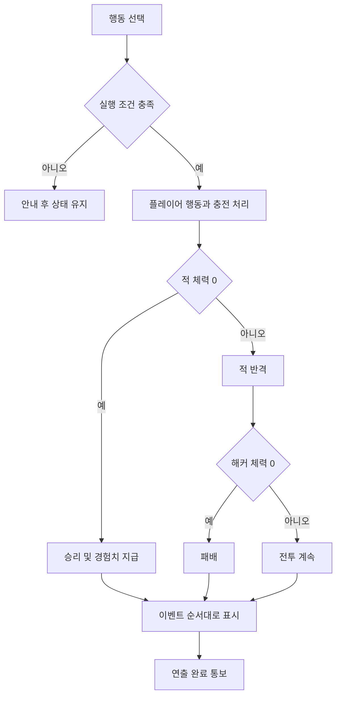
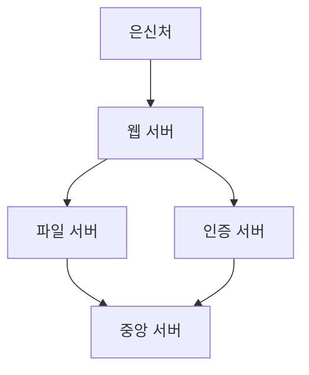
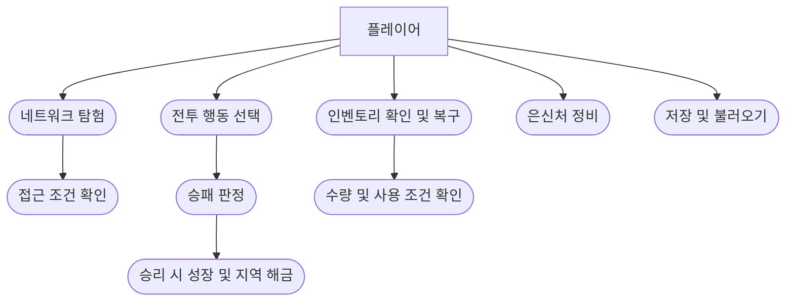
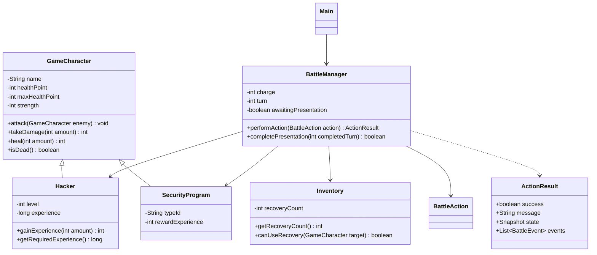

# 정보보안 콘셉트 턴제 RPG 작업 명세서

- 문서 버전: 0.1 (팀 검토용)
- 작성일: 2026-11-26
- 개발 언어: Java
- 패키지: `swg_eng_rpg_001`
- 저장소: https://github.com/LeeSan0919/sw-eng-rpg
- 기반 코드: 수업에서 사용한 `GameCharacter.java`

## 1. 프로젝트 개요 및 범위

플레이어가 해커 아바타로 가상의 네트워크를 탐험하고, 시스템을 지키는 보안 프로그램과 턴제 전투를 수행하는 Java GUI 게임을 개발한다. 전투 결과에 따라 경험치와 능력치를 갱신하고 다음 시스템의 접근 권한을 해금한다.

필수 범위는 텍스트·이미지 GUI, 네트워크 탐험, 턴제 전투, 방어, AI 에이전트 필살기, 경험치·레벨업, 은신처 회복, 인벤토리·복구 프로그램, 파일 저장·불러오기이다. 실제 네트워크 공격, 별도 서버 구축, AI API 호출은 구현 범위에 포함하지 않는다. ChatGPT 에이전트는 이미지와 정해진 피해 계산으로 표현한다.

현재 콘솔 실행본은 전투 로직을 확인하는 개발용 화면이다. 최종 제출본은 같은 로직에 GUI를 연결한다. 문서에서 **구현됨**은 작성·검증된 콘솔 코드, **구현 예정**은 제안서에 포함된 기능, **검토안**은 아직 팀 합의가 필요한 세부 규칙을 의미한다.

## 2. 팀원 및 담당 범위

| 구분 | 이름 | 학번 | 소속 | 담당 |
|---|---|---|---|---|
| A | 태영준 | 2021245107 | 소프트웨어학과 | GUI, 입력, 화면 전환, 이미지와 전투 연출 |
| B | 이 산 | 2022240219 | 경영학부/소프트웨어학과 | 게임 상태, 전투 규칙, 성장, 지역 진행, 저장·복원 |
| 공동 | A·B | — | — | 인터페이스 합의, 통합 검증, 문서 및 발표 |

A는 실제 체력·경험치·수량을 직접 변경하지 않고 B의 처리 메서드를 호출한다. B는 화면 버튼의 활성화 여부와 별개로 요청 조건을 검증한다.

## 3. 기능 요구사항

| ID | 기능 | 입력 및 사전조건 | 처리 및 결과 | 예외 처리 | 상태 |
|---|---|---|---|---|---|
| FR-01 | 새 게임 | 새 게임 선택 | 레벨 1, 체력 100, 공격력 15, 경험치 0, 복구 3개로 시작 | 기존 진행 초기화 전 안내 | 전투 초기화 구현됨, 시작 화면 예정 |
| FR-02 | 상태 표시 | 화면 진입 또는 행동 완료 | 체력·최대 체력·공격력·레벨·경험치·충전·수량 표시 | 전투 밖에서는 적 정보 숨김 | 콘솔 구현됨, GUI 예정 |
| FR-03 | 지역 이동 | 접근 가능한 지역 선택, 전투 밖 | 위치 변경, 미공략 전투 지역에서 적 생성 및 전투 시작 | 잠긴 지역·전투 중 이동 거절 | 구현 예정 |
| FR-04 | 지역 해금 | 해당 지역 전투 승리 | 공략 완료 기록, 조건을 만족한 다음 지역 해금 | 패배 시 공략 완료 처리 금지 | 구현 예정 |
| FR-05 | 일반 공격 | 전투 진행 중, 이전 연출 완료 | 공격력만큼 피해, 적 생존 시 반격 | 종료된 전투·연출 중 요청 거절 | 구현됨 |
| FR-06 | 방어 | FR-05와 동일 | 이번 적 반격 피해를 절반으로 감소 | 다음 행동까지 방어 효과 유지 금지 | 구현됨 |
| FR-07 | AI 에이전트 | 전투 진행 중, 충전 3, 연출 완료 | 공격력 2배 피해, 충전 0, 적 생존 시 반격 | 충전 부족 시 턴·체력 변경 없음 | 구현됨 |
| FR-08 | 승패 및 보상 | 각 공격 처리 직후 | 적 체력 0이면 승리·경험치 지급, 해커 체력 0이면 패배 | 승리 후 반격·보상 중복 지급 금지 | 구현됨 |
| FR-09 | 경험치·레벨업 | 전투 승리 | 경험치 지급, 기준 충족 동안 연속 레벨업, 초과분 이월 | 음수 경험치 거절 | 구현됨 |
| FR-10 | 은신처 정비 | 전투 밖, 은신처 위치 | 체력을 최대 체력까지 회복 | 최대 체력이면 변화 없이 안내 | 구현 예정 |
| FR-11 | 인벤토리 조회 | 조회 선택 | 복구 프로그램 설명과 수량 표시, 턴 소비 없음 | 수량 0도 표시 | 콘솔 구현됨, GUI 예정 |
| FR-12 | 복구 프로그램 | 살아 있음, 체력 부족, 수량 1 이상 | 최대 30 회복, 수량 1 차감; 전투 중 성공 시 적 반격 | 최대 체력·수량 부족 시 수량·턴·충전 유지 | 전투 중 구현됨, 전투 밖 예정 |
| FR-13 | 저장 | 저장 선택, 전투 밖 | 플레이어·아이템·위치·진행도를 파일 저장 | 전투 중 저장·쓰기 실패 안내 | 구현 예정; 전투 밖 제한은 검토안 |
| FR-14 | 불러오기 | 불러오기 선택, 전투 밖 | 파일 검증 후 게임 상태와 화면 복원 | 파일 없음·손상·지원하지 않는 버전 시 현재 상태 유지 | 구현 예정 |
| FR-15 | 전투 연출 | 성공한 행동 결과 수신 | 이벤트 순서대로 공격·피격·회복·필살기·승패 표시 | 연출 중 중복 입력 차단 | 결과 데이터 구현됨, GUI 예정 |

## 4. 전투 및 성장 규칙

### 4.1. 수치 기준

현재 코드에 적용한 초기 밸런스이며, 변경 시 코드와 본 문서를 함께 갱신한다.

| 항목 | 규칙 |
|---|---|
| 해커 초기 상태 | 레벨 1, HP 100/100, 공격력 15, 경험치 0 |
| 콘솔 예제 방화벽 | HP 80, 공격력 10, 처치 경험치 120 |
| 일반 공격 | 요청 피해 = 공격자의 공격력 |
| 실제 피해 | 요청 피해와 대상의 현재 HP 중 작은 값 |
| 방어 | 해당 반격 피해 = 적 공격력 / 2를 올림한 정수 |
| 필살기 | 요청 피해 = 해커 공격력 × 2 |
| 충전 | 공격·방어·복구 사용 성공마다 +1, 최대 3 |
| 필살기 사용 | 충전 3에서 선택 가능, 사용 즉시 0; 사용 턴에는 재충전하지 않음 |
| 충전 유지 | 충전 완료 후 다른 일반 행동을 해도 3 유지; 새 전투는 0 |
| 회복 | 실제 회복량 = min(30, 최대 HP - 현재 HP) |
| 레벨업 기준 | 현재 레벨 × 100; 다음 레벨에 필요한 전체 경험치 |
| 레벨업 효과 | 최대 HP +20, 공격력 +5; 현재 HP는 그대로 유지 |
| 경험치 이월 | 기준 경험치를 차감하고 남은 경험치에 대해 다시 레벨업 판정 |

공격·방어·복구 사용을 합쳐 3회 성공하면 네 번째 행동부터 필살기를 사용할 수 있다. 인벤토리 조회와 실행이 거절된 행동은 충전에 포함하지 않는다. 전투 밖 복구 사용은 전투 충전에 영향을 주지 않는다.

### 4.2. 한 턴의 처리 순서

전투 처리는 한 요청에서 계산하고, GUI는 결과에 포함된 시점별 상태를 순서대로 표시한다. 피해량을 화면에서 재계산하지 않는다. 적 처치 경험치는 현재 `BattleManager`에서 지급하므로 향후 `GameManager`에서 다시 지급하지 않는다.

## 5. 탐험 및 게임 진행 설계

### 5.1. 지역 구성 검토안

아래 지도와 해금 조건은 구현을 위한 초안이며, 기존에 확정된 지도 데이터가 아니다.

| 지역 ID | 표시명 | 최초 접근 | 해금 조건 | 전투 |
|---|---|---|---|---|
| hideout | 은신처 | 가능 | 없음 | 없음 |
| web | 웹 서버 | 가능 | 없음 | 방화벽 |
| file | 파일 서버 | 불가 | 웹 서버 공략 | 배치할 적·수치 팀 검토 |
| auth | 인증 서버 | 불가 | 웹 서버 공략 | 배치할 적·수치 팀 검토 |
| core | 중앙 서버 | 불가 | 파일 서버와 인증 서버 모두 공략 | 최종 적·수치 팀 검토 |

화살표는 해금 의존 관계를 나타낸다. 검토안에서는 전투 밖에서 해금된 지역 중 원하는 곳을 선택할 수 있다. 분기 지역은 어느 쪽부터 공략해도 나머지 지역이 잠기지 않는다.

### 5.2. 진행 규칙 검토안

- 지역마다 지정한 적 1개를 생성하고 승리하면 해당 지역을 공략 완료로 기록한다.
- 공략 완료 지역은 재방문할 수 있지만 전투와 경험치 지급은 반복하지 않는다.
- 첫 지역 공략 이후에도 현재 HP·경험치·아이템 수량을 그대로 유지한다.
- 은신처 정비는 무료 전체 회복이며, 복구 프로그램 수량은 보충하지 않는다.
- 최초 지역 공략 보상으로 복구 프로그램 1개를 지급하는 방식을 제안한다. 재방문 시 지급하지 않는다.
- 패배 시 공략 상태를 변경하지 않고 은신처로 복귀하여 HP를 최대치로 회복하는 방식을 제안한다. 사용한 복구 프로그램은 반환하지 않는다.
- 중앙 서버 공략 시 완료 안내를 표시한다.

## 6. 유스케이스

### 6.1. 사용자와 기능 관계

다음 도식은 플레이어가 수행하는 기능과 기능 간 관계를 표현한 유스케이스 개요이다.

### 6.2. 주요 시나리오

| ID | 유스케이스 | 사전조건 | 기본 흐름 | 예외 흐름 및 사후조건 |
|---|---|---|---|---|
| UC-01 | 시스템 공략 | 전투 밖 | 지도 선택 → 접근 검사 → 적 생성 → 전투 화면 | 잠금 상태이면 위치 유지; 승리 시 공략 상태 갱신 |
| UC-02 | 일반 공격 | 전투 진행, 연출 완료 | 공격 선택 → 피해 → 적 생존 시 반격 → 로그·상태 표시 | 적 사망 시 반격 생략; 연출 중 요청 거절 |
| UC-03 | 필살기 | 충전 3 | 호출 → 충전 초기화 → 강화 피해 → 승패 확인 | 충전 부족이면 턴 유지 |
| UC-04 | 복구 사용 | HP 부족, 수량 존재 | 사용 → 회복 → 수량 차감 → 전투 중이면 반격 | 최대 HP·수량 0이면 소비 없음 |
| UC-05 | 은신처 정비 | 은신처, 전투 밖 | 정비 선택 → 최대 HP까지 회복 → 상태 표시 | 전투 중 또는 다른 위치이면 거절 |
| UC-06 | 저장 | 전투 밖 | 저장 요청 → 데이터 수집 → 파일 쓰기 → 결과 안내 | 실패 시 오류 안내, 기존 저장 보호 |
| UC-07 | 불러오기 | 전투 밖 | 파일 읽기 → 전체 검증 → 상태 교체 → 화면 갱신 | 검증 실패 시 기존 플레이 유지 |

## 7. 클래스 구조 및 데이터 규격

### 7.1. 현재 구현된 클래스

`Snapshot`과 `BattleEvent`는 `ActionResult` 내부의 변경 불가능한 중첩 클래스이다. GUI는 원본 캐릭터 참조 대신 이 데이터를 사용한다. `Inventory.useRecovery(GameCharacter)`는 같은 패키지의 게임 로직에서 호출한다. 필드가 private이라는 점만으로 GUI의 변경이 차단되는 것은 아니므로, 공개 setter와 캐릭터 참조를 GUI에서 사용하지 않는 연결 원칙을 지킨다.

### 7.2. 추가할 클래스

| 클래스 | 역할 | 담당 |
|---|---|---|
| GameState | 해커·인벤토리·현재 위치·지역 진행 상태 보관 | B |
| Region | 지역 ID·이름·해금 조건·적 정의 | B |
| GameManager | 이동·전투 진입·종료 후 진행·정비·저장 요청 연결 | B |
| SaveManager | 파일 변환·검증·저장·복원 | B |
| GameFrame | 전체 GUI 및 화면 전환 | A |
| MapPanel | 지역 표시와 선택 | A |
| BattlePanel | 전투 표시·입력·연출 | A |
| InventoryDialog | 도구 목록·설명·사용 | A |
| ImageManager | 이미지 읽기·재사용·누락 시 대체 표시 | A |

### 7.3. 상태 데이터의 제약

| 데이터 | 형식 | 제약 |
|---|---|---|
| name, typeId, regionId | String | null·공백 금지; ID는 정의된 값 사용 |
| healthPoint | int | 0 이상, 최대 HP 이하 |
| maxHealthPoint | int | 양수 |
| strength | int | 0 이상 |
| level | int | 1 이상 |
| experience | long | 0 이상, 정상 상태에서 다음 레벨 기준 미만 |
| recoveryCount | int | 0 이상 |
| charge | int | 0~3 |
| turn | int | 성공한 플레이어 행동 수, 시작 0 |
| unlockedRegionIds | Set<String> | 중복 없는 접근 가능 지역 ID; 예정 |
| clearedRegionIds | Set<String> | 중복 없는 공략 완료 지역 ID; 예정 |

화면의 전투 Snapshot에는 `playerHp`, `playerMaxHp`, `playerStrength`, `playerLevel`, `experience`, `requiredExperience`, `enemyHp`, `enemyMaxHp`, `charge`, `turn`, `recoveryCount`, `outcome`을 포함한다. 적 이름·종류 ID는 전투 진입 시 화면에 별도로 제공하도록 설계한다.

## 8. 프런트엔드·백엔드 인터페이스

### 8.1. 현재 사용 가능한 전투 인터페이스

| 메서드 | 입력 | 반환 및 처리 |
|---|---|---|
| BattleManager(Hacker, SecurityProgram, Inventory) | 살아 있는 해커·적, 플레이어 인벤토리 | 전투 생성; 충전·턴 0 |
| performAction(BattleAction) | ATTACK, DEFEND, CALL_AI_AGENT, USE_RECOVERY | ActionResult; 성공 시 행동과 반격·보상까지 처리 |
| getSnapshot() | 없음 | 현재 전투 상태의 읽기 전용 복사 |
| canAct() | 없음 | 행동 가능 여부 |
| canCallAiAgent() | 없음 | 행동 가능 및 충전 완료 여부 |
| canUseRecovery() | 없음 | 행동 가능 및 회복 조건 만족 여부 |
| completePresentation(int completedTurn) | 성공 결과의 state.turn | 일치하는 대기 연출을 완료하면 true, 그 외 false |

두 인자 `BattleManager(Hacker, SecurityProgram)`는 호환용으로 빈 인벤토리를 생성한다. 실제 게임은 세 인자 생성자에 같은 플레이어 인벤토리를 전달하여 전투마다 아이템이 초기화되지 않게 한다.

`ActionResult.success=false`이면 events는 비어 있고 message에 실패 이유를 전달한다. 상태 변화와 턴 소비는 없다. 성공 결과는 순서가 있는 events와 최종 state를 포함한다. 각 이벤트는 type, message, damage, recovered, 해당 시점의 state를 가진다. 이벤트 종류는 PLAYER_ATTACK, DEFEND, AI_AGENT, RECOVERY, ENEMY_ATTACK, VICTORY, DEFEAT, REWARD이다.

### 8.2. 연출 연결 절차

1. 입력을 받은 화면이 행동 요청을 보낸다.
2. 백엔드는 조건 확인 후 상태를 변경하고 결과를 반환한다.
3. 화면은 실패면 안내만 표시하고, 성공이면 버튼 입력을 잠근다.
4. events 순서대로 이미지를 교체하고 각 이벤트의 state를 표시한다.
5. 마지막 이벤트 표시 후 최종 state를 반영한다.
6. 해당 전투 객체에 `completePresentation(result.state.turn)`을 호출한다.
7. 전투가 계속되면 조건에 맞춰 버튼을 활성화하고, 종료되면 결과 화면으로 전환한다.

현재 `BattleManager`는 요청을 단일 GUI 이벤트 흐름에서 순차 처리하는 것을 전제로 한다. 연출 완료 콜백은 자신이 시작된 전투 객체를 대상으로 하며, 새 전투에 이전 콜백을 전달하지 않는다. GUI 타이머를 사용하고 화면 스레드에서 대기용 `Thread.sleep()`을 호출하지 않는다.

### 8.3. 탐험 및 저장 인터페이스 설계안

아래 API와 자료형은 아직 구현되지 않았으며, GUI 연결 전에 공동 확정한다.

| GameManager 메서드 | 반환형 | 계약 |
|---|---|---|
| startNewGame() | void | 플레이 상태를 초기화; 진행 중 게임 교체는 UI 확인 이후 수행 |
| getView() | GameView | 플레이어·위치·지역 상태·수량의 읽기 전용 복사 |
| moveTo(String regionId) | OperationResult | 접근 검증 후 이동; 필요하면 전투 시작 |
| performBattleAction(BattleAction action) | ActionResult | 현재 BattleManager에 위임 |
| completeBattlePresentation(int turn) | boolean | 연출 완료와 전투 종료 후 지역 갱신 연결 |
| restAtHideout() | OperationResult | 위치·전투 상태 확인 후 회복 |
| useRecoveryItem() | OperationResult | 전투 밖 회복; 전투 중은 performBattleAction 사용 |
| saveGame(Path path) | OperationResult | 전투 밖 저장 |
| loadGame(Path path) | OperationResult | 파일 전체 검증 후 상태 교체 |

`GameView`와 `OperationResult`는 별도 파일 수를 줄이기 위해 `GameManager` 내부의 읽기 전용 중첩 클래스로 정의하는 안을 사용한다. `OperationResult`는 success, message, view를 포함한다. 전투 결과인 `ActionResult`에 전투 밖의 가짜 적 정보를 넣지 않는다.

## 9. 저장 데이터 설계안

전투 밖에서만 저장하며, Java `Properties` 형식의 파일을 사용하는 안을 제안한다. UTF-8 Reader/Writer로 처리하고 숫자 형식을 검증한다. GUI 객체·이미지·현재 적·연출 대기 상태는 저장하지 않는다.

| 키 | 값 예시 | 내용 |
|---|---|---|
| saveVersion | 1 | 저장 형식 버전 |
| player.name | 해커 | 이름 |
| player.level | 2 | 레벨 |
| player.experience | 20 | 현재 레벨의 잔여 경험치 |
| player.hp | 80 | 현재 HP |
| player.maxHp | 120 | 최대 HP |
| player.strength | 20 | 공격력 |
| inventory.recoveryCount | 2 | 보유 수량 |
| world.currentRegionId | hideout | 현재 위치 |
| world.unlockedRegionIds | hideout,web,file,auth | 접근 가능 지역 |
| world.clearedRegionIds | web | 공략 완료 지역 |

위 값은 형식 예시이다. 현재 전투 코드에는 아직 지역 상태가 없다.

불러오기 시 필수 키, 버전, 숫자 범위, 지역 ID, 공략 완료 지역의 접근 가능 여부, 해금 조건의 일관성을 확인한다. 현재 성장 규칙에 맞는 능력치인지도 확인한다. 검증된 임시 객체를 만든 뒤 한 번에 현재 상태를 교체한다. `Hacker`의 레벨·경험치를 직접 복원하는 기능은 현재 없으므로 별도 복원 생성자 또는 팩터리를 추가할 예정이다.

저장은 먼저 임시 파일에 쓰고 성공한 뒤 대상 파일을 교체한다. 기존 저장 파일을 먼저 삭제하지 않는다. 파일 없음·읽기 실패·잘못된 데이터·쓰기 실패는 사용자가 이해할 수 있는 메시지로 안내한다.

## 10. 화면 및 이미지 명세

GUI 구성 도구는 Swing을 기준으로 한 검토안이며, 팀 개발 환경의 JDK 버전과 함께 확정한다.

| 화면 | 표시 항목 | 사용자 입력 |
|---|---|---|
| 시작 화면 | 제목, 새 게임, 불러오기 | 시작·복원·종료 |
| 지도 화면 | 지역, 접근·공략 상태, 플레이어 상태 | 지역 선택·인벤토리·저장 |
| 전투 화면 | 해커·적 이미지, 양측 HP, 충전, 로그 | 공격·방어·에이전트·복구 |
| 은신처 영역 | 정비 설명, 현재 HP | 정비·탐험 복귀 |
| 인벤토리 창 | 복구 프로그램 수량과 효과 | 사용·닫기 |
| 결과 영역 | 승패, 경험치, 레벨업, 지역 해금 | 다음 화면 이동 |

- 배경은 검정·어두운 회색, 해커 및 UI 강조는 형광 연두색으로 구성한다.
- 해커는 흰 가면과 검은 후드, 방화벽은 검정 계열의 근육질 몸체와 형광 분홍색 요소 및 ‘방화벽’ 글자로 표현한다.
- 공격자 공격 이미지와 대상 피격 이미지는 각각 독립적으로 교체한다.
- 필살기는 화면 하단의 해커 뒤에 약 4배 크기의 ChatGPT 로봇이 등장하는 구상 이미지를 사용한다.
- 넉다운 표현은 해당 리소스 확보 후 적용하며, 없으면 기본 이미지의 비활성화와 텍스트로 대체한다.
- 상태와 로그는 GUI 텍스트로 표시하며 이미지에 포함된 예시 수치를 게임 데이터로 사용하지 않는다.
- ChatGPT 구독권은 구상 이미지의 예시 아이템이다. 실제 효과와 획득 조건이 확정되지 않았으므로 현재 필수 구현 및 필살기 사용 조건에 넣지 않는다.
- 이미지 파일명과 대소문자를 실제 리소스와 맞추고, 누락 시 대체 표시와 안내를 제공한다.

## 11. 비기능 요구사항

| ID | 요구사항 | 구현 및 확인 기준 |
|---|---|---|
| NFR-01 | 재사용성 | 체력·피해·회복은 GameCharacter에서 공유; 같은 행동의 적은 데이터로 구분 |
| NFR-02 | 처리 효율 | 입력이 발생할 때 턴 계산; 지속적인 상태 확인 반복문 사용 금지; 이미지는 읽은 후 재사용 |
| NFR-03 | UI 응답성 | 연출은 GUI 타이머 사용; 파일 작업이 길어져도 UI가 멈추지 않도록 처리 |
| NFR-04 | 상태 일관성 | 실제 상태는 백엔드에서 변경; 화면은 읽기 전용 결과를 표시 |
| NFR-05 | 오류 내성 | 무효 행동은 상태 유지; 손상된 저장 파일은 현재 플레이를 덮어쓰지 않음 |
| NFR-06 | 유지보수성 | 패키지 통일, 역할별 클래스 분리, 상수로 밸런스 관리 |
| NFR-07 | 실행 재현성 | README에 확정 JDK·실행 진입점·리소스 배치·조작법 기록; 두 팀원 환경에서 실행 확인 |

일반 공격·방어·회복의 계산량은 고정되어 있다. 레벨업은 실제 상승한 레벨 수만큼 반복한다. 게임 규모에 맞지 않는 복잡한 최적화보다 중복 제거와 올바른 상태 관리에 우선순위를 둔다.

## 12. 인수 및 통합 테스트

| ID | 관련 요구사항 | 조건·입력 | 기대 결과 |
|---|---|---|---|
| T-01 | FR-01 | 새 게임 | 레벨 1, HP 100/100, 공격력 15, 경험치 0, 복구 3 |
| T-02 | FR-05 | 예제 방화벽에 일반 공격 | 적 HP 80→65, 반격 후 해커 HP 100→90 |
| T-03 | FR-06 | 공격력 11인 적에게 방어 | 받은 피해 6, 다음 일반 행동에서는 피해 11 |
| T-04 | FR-07 | 시작 즉시 필살기 선택 | 실패, 턴·충전·HP 변화 없음 |
| T-05 | FR-07 | 일반 행동 3회 후 필살기 | 공격력 2배 피해, 충전 0 |
| T-06 | FR-08 | 적 HP 10에서 공격력 15로 공격 | 실제 피해 10, 반격 없음, 경험치 1회 지급 |
| T-07 | FR-09 | 레벨 1에서 경험치 350 획득 | 레벨 3, 잔여 50, 최대 HP 140, 공격력 25 |
| T-08 | FR-12 | HP 90에서 복구 | 실제 회복 10, 수량 -1; 전투 중이면 이후 반격 |
| T-09 | FR-12 | 최대 HP 또는 수량 0에서 복구 | 턴·수량·충전 유지 |
| T-10 | FR-11 | 인벤토리 조회 | 수량과 설명 표시, 턴 변화 없음 |
| T-11 | FR-15 | 연출 완료 전 두 번째 요청 | 거절, 중복 피해·소모 없음 |
| T-12 | FR-04 | 웹 서버 공략 | 파일·인증 서버 모두 접근 가능; 진행 규칙 합의 후 적용 |
| T-13 | FR-10 | 손상된 HP로 은신처 정비 | 최대 HP 회복, 아이템 수량 유지 |
| T-14 | FR-13·14 | 저장 후 재실행 및 불러오기 | 플레이어·수량·위치·진행도 동일 |
| T-15 | FR-14 | 파일 없음·손상·알 수 없는 버전 | 오류 안내, 기존 게임 상태 유지 |
| T-16 | FR-03·04 | 패배 후 같은 지역 재도전 | 지역 미공략 유지, 새 적의 HP는 초기값 |
| T-17 | 전투 통합 | 예제에서 1→1→1→4→3→1 | 6턴 승리, 레벨 2, 경험치 20, HP 80/120, 공격력 20, 복구 2 |

현재 검증 기록: 캐릭터 27개, 전투 41개, 인벤토리 25개 검사 및 콘솔 시나리오 5개를 통과했다. 이는 GUI·탐험·저장 기능의 검증 완료를 뜻하지 않는다. 향후 테스트 결과는 실제 실행 후 기록한다.

## 13. 개발 및 협업 계획

| 단계 | 산출물 | 담당 | 완료 기준 |
|---|---|---|---|
| 명세서 정리 | 본 문서와 미정 항목 합의 | 공동 | 제안서 기능과 인터페이스 일치; 목표 11월 30일 |
| 전투·성장·아이템 | 현재 Java 로직 | B | 콘솔 및 조건별 검증 완료 |
| 탐험·정비 | GameState, Region, GameManager | B | 이동→전투→해금→회복 연결 |
| GUI | 창·지도·전투·인벤토리·이미지 | A | 동일 로직을 GUI로 조작 가능 |
| 저장·불러오기 | SaveManager 및 복원 기능 | B | 정상 복원과 실패 시 상태 보호 |
| 통합·발표 | 실행본, README, 시연 | 공동 | 시작부터 최종 지역까지 진행; 기말고사 전 완료 목표 |

문서와 코드는 Git으로 변경 이력을 관리하고 GitHub 저장소에서 공유한다. API의 이름·입력·반환값을 바꾸기 전에 상대 담당자에게 변경 내용을 전달한다. `Main.java`는 공동 연결 지점이므로 동시에 수정하지 않도록 작업 범위를 조율한다. 각 기능의 구현 및 검증 결과에 맞춰 문서 상태를 갱신한다.

## 14. 제출 전 확정할 항목

1. 교수자의 명세서 전용 양식, 필수 항목, 분량 및 제출 형식 확인.
2. Swing 사용 여부와 두 팀원의 공통 JDK 버전.
3. 제5절 지도 구성, 중앙 서버 해금 조건, 적 종류와 능력치.
4. 재전투 허용 여부, 복구 프로그램 추가 지급, 패배 시 복귀·회복 규칙.
5. 전투 밖 저장 제한과 Properties 저장 형식.
6. GUI 연출 시간, 이미지 리소스 목록과 실제 파일 경로.

위 항목을 합의하면 검토안 표기를 정리하고 문서 버전을 1.0으로 갱신한다.
